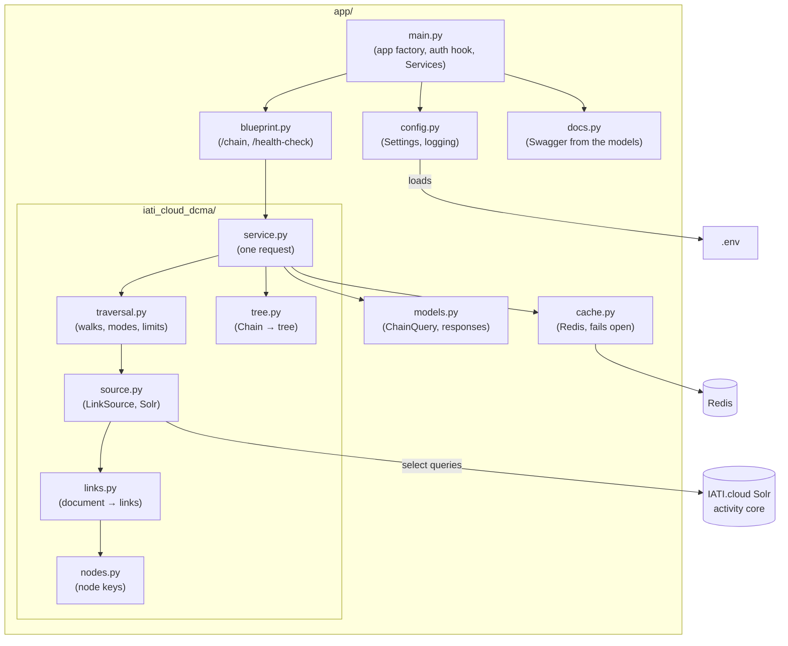
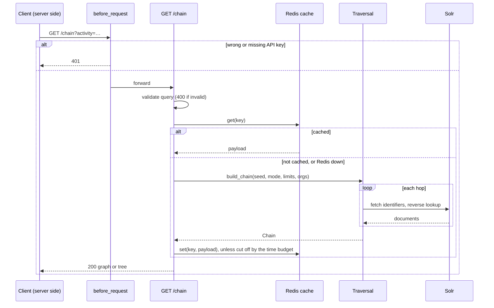
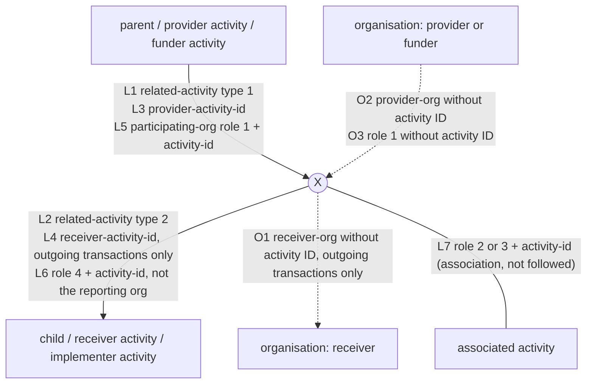
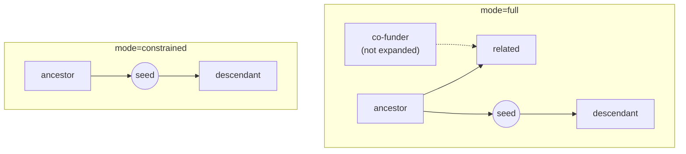
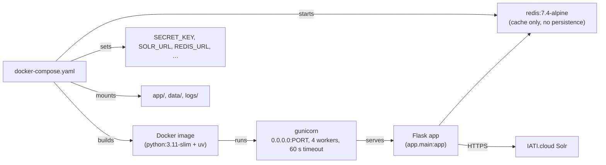

# Diagrams

## Application Architecture

## Request Flow

Errors: `404` when the seed is neither published nor referenced, `502` on a Solr error, `504` on a Solr timeout.

## Link Model

X is the activity whose document is read. Solid arrows are links between activities; dashed arrows end in an
organisation, where no activity is named. Arrows point from funder to funded.

## Traversal

Each hop of a walk fetches the frontier's documents by identifier (all copies of a duplicated identifier, merged),
then runs one reverse lookup for the documents that name them. A walk stops at `max_depth`, `max_nodes`, the reverse
lookup limit or the request's time budget, and the response lists which in `truncation_reasons`.

## Deployment

