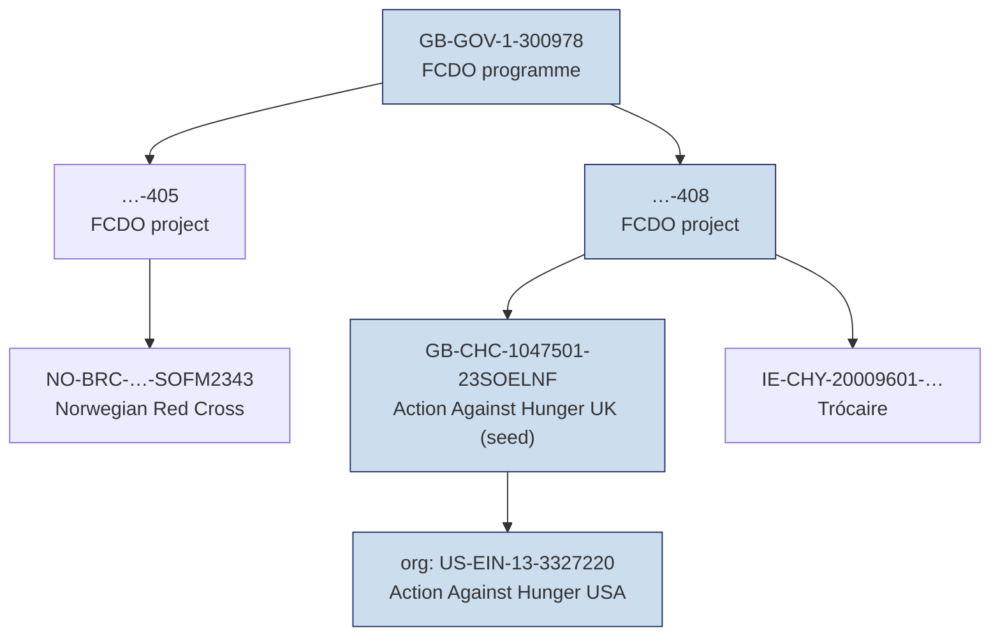
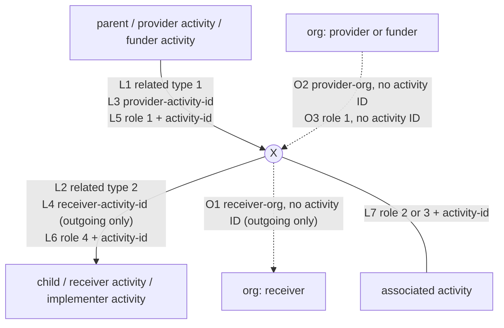
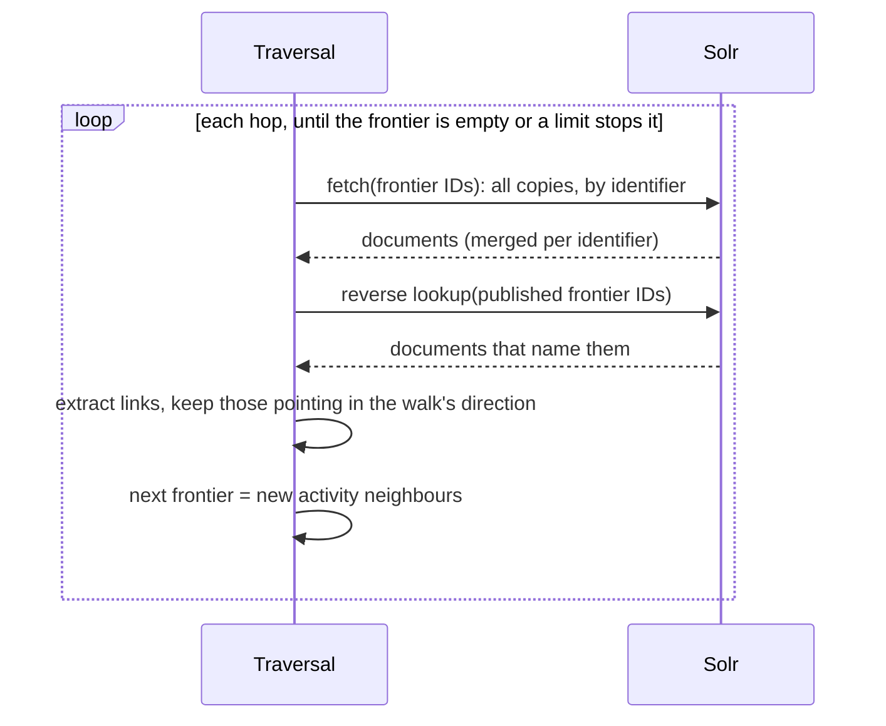

# Delivery Chain Mapping API: specification

| | |
|---|---|
| Version | 1.0 (baseline), 2026-11-17 |
| Status | Implemented and tested. For handover |

- [Delivery Chain Mapping API: specification](#delivery-chain-mapping-api-specification)
  - [1. Purpose](#1-purpose)
    - [1.1 Principles](#11-principles)
  - [2. Terms](#2-terms)
  - [3. Link model](#3-link-model)
    - [3.1 Data source](#31-data-source)
    - [3.2 Activity links](#32-activity-links)
    - [3.3 Organisation links](#33-organisation-links)
    - [3.4 Finding links declared by others](#34-finding-links-declared-by-others)
    - [3.5 Identifier and document rules](#35-identifier-and-document-rules)
  - [4. Traversal](#4-traversal)
    - [4.1 Walks](#41-walks)
    - [4.2 Modes](#42-modes)
    - [4.3 Limits and truncation](#43-limits-and-truncation)
  - [5. API](#5-api)
    - [5.1 `GET /chain`](#51-get-chain)
    - [5.2 Graph response](#52-graph-response)
    - [5.3 Tree response](#53-tree-response)
    - [5.4 Errors](#54-errors)
    - [5.5 `GET /health-check`](#55-get-health-check)
  - [6. Non-functional requirements](#6-non-functional-requirements)
  - [7. What the data allows, and what it does not](#7-what-the-data-allows-and-what-it-does-not)
  - [8. Acceptance cases](#8-acceptance-cases)
  - [9. Out of scope (possible extensions)](#9-out-of-scope-possible-extensions)
  - [10. Decisions and open questions](#10-decisions-and-open-questions)
    - [10.1 Decisions](#101-decisions)
    - [10.2 Open question for FCDO](#102-open-question-for-fcdo)
  - [Appendix: evidence](#appendix-evidence)


## 1. Purpose

Given one IATI activity identifier (the **seed**), the Delivery Chain Mapping API (DCM) returns the activities that fund it and the activities it funds. It follows published links recursively and returns the whole chain in one call.

Described initially as:

> For any programme/project in the delivery chain we should be able to see the full list of funding and funded programmes using a single API call that uses recursion.

It names two use cases:

| Mode | Use case | Returns |
|---|---|---|
| `full` | UC1: the whole delivery chain the seed belongs to | The seed, everything that funds it (up to the top), everything those funders fund (down to the bottom), and the direct co-funders of those. |
| `constrained` | UC2: only the line of funding through the seed | The seed, everything that funds it, everything it funds. Other branches of the same funders are left out. |



Blue is the constrained chain for the seed. The full chain is every node in the picture (and more; see §8).

The DCM is a standalone service. It reads IATI data live from an IATI.cloud Solr activity core and depends on no other Zimmerman API. Its expected consumer is a front-end such as DevTracker, calling it from the server side.

### 1.1 Principles

These come from the IATI publisher guidance on linking activities and from the internal notes on a 2016 DFID delivery-chain project.

- **A link joins two activities, or an activity and an organisation.** Transactions do not point at other transactions, so the DCM maps chains of activities. It does not trace money.
- **Use structured identifiers only.** Links come from published activity IDs and organisation refs. The DCM never guesses a link from a name.
- **Links are mostly declared by the recipient, pointing up.** IATI guidance asks a recipient to name its funder's activity; it does not ask the funder to name its recipients, and FCDO does not. To walk down from a funder, the DCM searches for activities that point at it.
- **Show gaps, do not hide them.** An activity that is referenced but not published, or a link that stops at an organisation, is returned and marked. Showing it is what gets data fixed.
- **Short chains are a property of the data, not a bug.** Most partners below the first tier do not publish, or do not publish links.

## 2. Terms

| Term | Meaning |
|---|---|
| Activity node | An IATI activity. Node ID = its `iati-identifier`. |
| Organisation node | An organisation named where no activity is named. Always the end of a chain; never searched further. Node ID = `org:<ref>`, or `org-name:<normalised name>` when it has no ref. The prefix keeps it apart from activity IDs, because publishers sometimes put an organisation ref where an activity ID belongs. |
| Edge | A directed link **upstream to downstream** (funder to funded), backed by one or more pieces of published evidence. |
| Association | An undirected relation from `participating-org` roles 2 (accountable) and 3 (extending). Shown, never followed. |
| Ancestors / descendants | Activities reachable from the seed going upstream / downstream. |
| Unpublished node | An activity ID that is referenced but not in the data source. |
| Declared by | The activities whose published data asserts a link. A link declared by both ends is reciprocated. |

## 3. Link model

### 3.1 Data source

An IATI.cloud Solr activity core, read-only, queried live on each request (`SOLR_URL`). The reference instance is `https://fcdo.iati.cloud/search/activity/`.

Fields read: `id`, `iati-identifier`, `last-updated-datetime`, `title.narrative`, `reporting-org.ref`, `reporting-org.narrative`, `hierarchy`, `activity-status.code`, `json.related-activity`, `json.transaction`, `json.participating-org`.

### 3.2 Activity links

X is the activity whose document is read. A link is ignored when the other end is X itself (publishers routinely name their own activity as provider of their outgoing transactions).



| # | Evidence in X | Result | Kind |
|---|---|---|---|
| L1 | `related-activity` type 1 (parent), ref P | P to X | `hierarchy` |
| L2 | `related-activity` type 2 (child), ref C | X to C | `hierarchy` |
| L3 | `transaction/provider-org/@provider-activity-id` = P, any transaction type | P to X | `transaction` |
| L4 | `transaction/receiver-org/@receiver-activity-id` = R, transaction type 2, 3, 4 or 12 only | X to R | `transaction` |
| L5 | `participating-org` role 1 (funding) with `@activity-id` = F | F to X | `participating-org` |
| L6 | `participating-org` role 4 (implementing) with `@activity-id` = I, and `@ref` is not X's reporting organisation | X to I | `participating-org` |
| L7 | `participating-org` role 2 or 3 with `@activity-id` = A | Association X – A | — |

Why the rules are as they are:

- **L3 holds for every transaction type.** In 3,928 outgoing transactions that name another activity as provider, that activity was a parent fund or a funder in every case read.
- **L4 applies to outgoing types only** (2 outgoing commitment, 3 disbursement, 4 expenditure, 12 outgoing pledge). On incoming transactions `receiver-activity-id` does not mean "X funds R": in a sample of 629, 185 named the activity's own parent, which would make the child fund its parent. A transaction with a missing or unreadable type gives no L4.
- **L6 skips the reporting organisation.** 38 % of role-4 entries with an activity ID name the reporting organisation itself. They say who implements this activity, not whom it funds. An entry without `@ref` is compared by name (§3.3); with neither ref nor name, the edge is kept.
- **L7 is shown, not followed.** Roles 2 and 3 are rarer (in a sample of 2,000, 124 and 51 against 670 for role 1), their direction is unclear, and their values are sometimes organisation refs. An association is dropped when an edge already joins the same two activities in the result, in either direction.
- **Not used:** `related-activity` type 3 (sibling): every FCDO project lists all its siblings, so following them would pull in whole portfolios and break `constrained`. Types 4 (co-funded) and 5 (third party): open question, §10.2.
- Edges are merged by (from, to), keeping the union of `kinds` and `declared_by`.

### 3.3 Organisation links

An organisation link is made only where the element names **no activity**, and the organisation is not X's reporting organisation.

| # | Evidence in X | Edge | Kind |
|---|---|---|---|
| O1 | `transaction/receiver-org`, no `@receiver-activity-id`, transaction type 2, 3, 4 or 12 | X to org | `transaction` |
| O2 | `transaction/provider-org`, no `@provider-activity-id` | org to X | `transaction` |
| O3 | `participating-org` role 1, no `@activity-id` | org to X | `participating-org` |

Each organisation node has an `identification` level. The `orgs` parameter (§5.1) picks which levels are returned:

| Level | When | Node ID | Returned with |
|---|---|---|---|
| `identifier` | `@ref` present, no whitespace | `org:<ref>` | every `orgs` value (default `identified` returns only these) |
| `free-text` | `@ref` present but contains whitespace: a name or note typed into `@ref`, such as `"BRAC UK"` | `org:<ref>` | `orgs=refs` or `orgs=all` |
| `name-only` | no `@ref`, a name is present | `org-name:<name, trimmed, lower-cased, inner whitespace collapsed>` | `orgs=all` |

- "Not the reporting organisation" compares refs; for a name-only organisation, it compares the normalised name with the reporting organisation's first non-empty name.
- A name-only node is never merged with a ref-based node, even when the names are equal. The DCM does not guess.
- `name` is the first non-empty narrative among the elements that created the node.
- Organisations left out by `orgs` do not count towards `max_nodes`.
- Organisation nodes cost no extra Solr queries.

Name-only organisations matter: in the 25 projects of `GB-GOV-1-300978`, 41 % of the receiver organisations have a name but no ref.

### 3.4 Finding links declared by others

An activity's own document shows only the links it declares. Links that other activities declare about it are found with one reverse lookup per batch of identifiers, across all link fields:

```
transaction_provider_org_provider_activity_id:(ids) OR transaction_receiver_org_receiver_activity_id:(ids)
OR related_activity_ref:(ids) OR participating-org.activity-id:(ids)
```

Matches are candidates only. A candidate counts when the rules in §3.2 yield an edge or association whose other end is one of the identifiers (§3.5). `participating-org.activity-id` is a tokenised field, so a search for `GB-GOV-1-300978` also matches `GB-GOV-1-300978-408`; that match does not count.

Without the reverse lookup nothing would be found below FCDO: `GB-GOV-1` publishes no `receiver-activity-id` on any of its activities.

### 3.5 Identifier and document rules

| Rule | Detail |
|---|---|
| Trim | Leading and trailing whitespace is removed from every identifier and ref. Numbers are read as strings. |
| Letter case | Activity identifiers and organisation refs are compared case-insensitively everywhere. A seed typed in lower case gives the same chain. An activity is shown with the spelling of its published document (the copy chosen below), or the first spelling seen when unpublished. |
| Case in the reverse lookup | Three of the four Solr link fields match case-sensitively. The reverse lookup therefore asks for every spelling seen so far, and repeats the walks (at most 3 rounds) when a new spelling turns up. An unpublished seed is only found under the spelling the caller typed. |
| Duplicates | Some identifiers have several documents (2,486 identifiers, one with 357 copies), and copies can declare different links. All copies are one node. Its links are the union over all copies. Its title, reporting org, hierarchy and status come from the copy with the latest `last-updated-datetime` (a copy without one counts as oldest; ties go to the lowest Solr `id`). |
| Completeness | A node's own links are complete only after a fetch by identifier. A document found through a reverse lookup may be one copy of several, so it is fetched again before the node is expanded. |
| Length | An identifier or ref longer than 255 characters is ignored. |
| Bad values | Unparseable JSON values are logged and skipped, never fatal. A document without an identifier is skipped. |
| Wrong content in activity-ID fields | Organisation refs, free text or several IDs in one field become unpublished activity nodes. This shows the data problem; it is not corrected. |
| `/` in identifiers | IATI identifiers can contain `/`. The seed is a query parameter, never a path segment. |
| Paging and batching | Results are sorted by `iati-identifier asc, id asc`, at least 100 rows per page. At most 200 identifiers per query (`ID_BATCH_SIZE`, configurable up to 250). |

## 4. Traversal

### 4.1 Walks



- The up-walk follows edges upstream, the down-walk downstream. Both are breadth-first, with a visited set against cycles.
- Only published activities are expanded. The one exception: an unpublished seed that others reference is expanded through the reverse lookup.
- Each identifier is fetched and reverse-looked-up at most once per walk round.

### 4.2 Modes

| Mode | Activity nodes |
|---|---|
| `constrained` | {seed} ∪ up-walk(seed) ∪ down-walk(seed) |
| `full` | A = {seed} ∪ up-walk(seed); D = down-walk(A); result = A ∪ D ∪ co-funders. Co-funders are the direct upstream neighbours of D that are not in A ∪ D. They are returned but not expanded, so a co-funder's whole portfolio is not pulled in. |

- Upstream organisations (O2, O3) are added for nodes walked upward, and in `full` mode as co-funders of D. Downstream organisations (O1) are added for nodes walked downward.
- An organisation is a dead end: an activity that names as its funder an organisation the seed pays is not a descendant of the seed.
- Associations are returned only when both activities are in the result. All edges between returned nodes are returned.
- No filters on status, dates, country or sector. A closed programme is still part of the chain.

Each node has one `relation`, by precedence:

| `relation` | Meaning |
|---|---|
| `seed` | The activity asked about. |
| `ancestor` | Funds the seed, directly or indirectly. |
| `descendant` | Funded by the seed, directly or indirectly. |
| `related` | `full` only: funded by an ancestor, but not below the seed. |
| `co-funder` | `full` only: funds a `descendant` or `related` node, but is not itself in the chain. Not expanded. |

`distance` is the shortest hop count from the seed over the returned edges, ignoring direction.

### 4.3 Limits and truncation

| Limit | Default | Reason code in `truncation_reasons` |
|---|---|---|
| `max_depth`: hops per walk (configurable, at most 50) | 20 | `max_depth` |
| `max_nodes`: nodes returned, organisations included | 1,000 | `max_nodes` |
| A reverse lookup stops after `max_nodes` documents (guards against activities cited by thousands, such as `XM-OCHA-CERF`) | — | `mention_limit` |
| `REQUEST_TIMEOUT`: time budget per request | 30 s | `time_budget` |

- A stopped traversal still answers `200`, with `truncated: true` and the reasons that applied.
- A node has `expanded: true` only when all its neighbours were enumerated and are in the result. Organisation nodes are always `expanded: false`.
- Admission order: the seed, then ancestors, then descendants, each breadth-first and by identifier. With a low `max_nodes`, ancestors fill the result first.
- Callers may lower `max_depth` and `max_nodes`, not raise them above the configured values.

## 5. API

All routes are under `/iati-cloud-dcma`. Every route except `/health-check` and the Swagger pages needs the `Authorization` header to equal the configured `SECRET_KEY`. `OPTIONS` requests (CORS preflights) pass without a key. The API is meant to be called server to server; the key must not reach a browser.

Swagger UI: `/iati-cloud-dcma/docs/`. OpenAPI spec: `/iati-cloud-dcma/apispec.json`.

### 5.1 `GET /chain`

| Parameter | Values | Default | Notes |
|---|---|---|---|
| `activity` | string, required | — | The seed. Trimmed; 1–255 characters, no control characters; any letter case. URL-encode it. |
| `mode` | `full`, `constrained` | `full` | §4.2 |
| `format` | `graph`, `tree` | `graph` | §5.2, §5.3 |
| `orgs` | `identified`, `refs`, `all` | `identified` | Which organisation nodes to return (§3.3). |
| `max_depth`, `max_nodes` | integer ≥ 1 | configured | Capped at the configured values. |

### 5.2 Graph response

Live response for `?activity=GB-CHC-1047501-23SOELNF&mode=constrained` (2026-11-17, key order tidied):

```json
{
  "seed": "GB-CHC-1047501-23SOELNF",
  "mode": "constrained",
  "format": "graph",
  "orgs": "identified",
  "truncated": false,
  "truncation_reasons": [],
  "stats": { "nodes": 4, "edges": 3, "associations": 0, "solr_queries": 6, "duration_ms": 387, "cached": false },
  "nodes": [
    { "id": "GB-CHC-1047501-23SOELNF", "type": "activity", "iati_identifier": "GB-CHC-1047501-23SOELNF",
      "title": "Integrated emergency life-saving Health, Nutrition WASH and Protection support for vulnerable populations affected by adverse effects of El Niño in South Central Somalia",
      "reporting_org": { "ref": "GB-CHC-1047501", "name": "Action Against Hunger UK" },
      "hierarchy": 1, "activity_status": "4", "published": true,
      "relation": "seed", "distance": 0, "expanded": true },
    { "id": "GB-GOV-1-300978-408", "type": "activity", "iati_identifier": "GB-GOV-1-300978-408",
      "title": "Integrated Emergency life-saving Health, Nutrition, WASH and Protection support in Somalia - Caafimaad Plus Consortium",
      "reporting_org": { "ref": "GB-GOV-1", "name": "UK - Foreign, Commonwealth Development Office (FCDO)" },
      "hierarchy": 2, "activity_status": "2", "published": true,
      "relation": "ancestor", "distance": 1, "expanded": true },
    { "id": "org:US-EIN-13-3327220", "type": "organisation", "org_ref": "US-EIN-13-3327220",
      "name": "ACTION AGAINST HUNGER USA", "identification": "identifier",
      "relation": "descendant", "distance": 1, "expanded": false },
    { "id": "GB-GOV-1-300978", "type": "activity", "iati_identifier": "GB-GOV-1-300978",
      "title": "Humanitarian Assistance and Resilience Building in Somalia (HARBS) 2022-2028",
      "reporting_org": { "ref": "GB-GOV-1", "name": "UK - Foreign, Commonwealth Development Office (FCDO)" },
      "hierarchy": 1, "activity_status": "2", "published": true,
      "relation": "ancestor", "distance": 2, "expanded": true }
  ],
  "edges": [
    { "from": "GB-CHC-1047501-23SOELNF", "to": "org:US-EIN-13-3327220",
      "kinds": ["transaction"], "declared_by": ["GB-CHC-1047501-23SOELNF"] },
    { "from": "GB-GOV-1-300978", "to": "GB-GOV-1-300978-408",
      "kinds": ["hierarchy"], "declared_by": ["GB-GOV-1-300978", "GB-GOV-1-300978-408"] },
    { "from": "GB-GOV-1-300978-408", "to": "GB-CHC-1047501-23SOELNF",
      "kinds": ["transaction", "participating-org"], "declared_by": ["GB-CHC-1047501-23SOELNF"] }
  ],
  "associations": []
}
```

Field rules:

- `seed` is the identifier as published, whatever case was typed.
- An unpublished activity has `published: false` and `title`, `reporting_org`, `hierarchy`, `activity_status` null.
- An organisation node has `org_ref` (null for `name-only`), `name` (may be null) and `identification`.
- An association is `{"activities": ["<id>", "<id>"], "role": 2 | 3, "declared_by": ["<id>"]}`, the two IDs sorted.
- `stats.solr_queries` and `stats.duration_ms` describe the request that built the result; `stats.cached` says whether this response came from the cache.

### 5.3 Tree response

`format=tree` returns the same header fields, then `tree`, `extra_edges` and `associations`.

- The tree is derived from the graph result, never from a second traversal, so both formats describe the same chain.
- The root is the seed. Every node appears once, under the node that reached it first in a breadth-first search over the returned edges, ignoring direction. Tie-break: `hierarchy` edges, then `transaction`, then `participating-org`, then node ID.
- Each tree node has `upstream` (its funders) and `downstream` (what it funds) child lists, set by the direction of the connecting edge.
- Edges the tree does not use are in `extra_edges`, so no link is lost.

### 5.4 Errors

Body: `{"error": "<message>"}`. Messages never contain Solr URLs, queries or stack traces; those go to the server log.

| Status | When |
|---|---|
| 400 | Missing or invalid `activity`; unknown `mode`, `format` or `orgs`; a limit that is not a positive integer |
| 401 | Missing or wrong API key |
| 404 | The seed is not published and no published activity references it |
| 502 | Solr returned an error, or could not be reached after the connection retries |
| 504 | Solr timed out, or the time budget ran out before the seed could be read |

An unpublished seed that others reference is not a 404: it returns `200` with the seed as an unpublished node.

### 5.5 `GET /health-check`

No API key. Response: `{"status": …, "timestamp": …, "dependencies": {"solr": "ok" | "unavailable", "cache": "ok" | "unavailable"}}`.

| Situation | Code | `status` |
|---|---|---|
| Solr and Redis answer | 200 | `healthy` |
| Solr answers, Redis does not | 200 | `degraded` (requests still work, uncached) |
| Solr does not answer | 503 | `unhealthy` |

## 6. Non-functional requirements

| Area | Requirement | State on 2026-11-17 |
|---|---|---|
| Cache | Redis. Key = SHA-256 of (`activity` trimmed and case-folded, `mode`, `format`, `orgs`, effective `max_depth`, effective `max_nodes`). TTL `CACHE_TTL` (24 h). Not cached: a result cut short by `time_budget` (one slow moment would be served for a day), and the result for an unpublished seed (it depends on the spelling typed). Redis failures are logged and the response is served uncached. | Unit-tested and ran against real Redis |
| Performance | Uncached p95 under 10 s for chains up to 500 nodes; cached p95 under 300 ms. | Uncached met: all 24 measured requests under 2 s at the former defaults (`max_depth` 10, `max_nodes` 500; `BASELINE_MEASUREMENTS.md`). At `max_nodes` 1,000 the slowest measured chain (`XM-OCHA-CERF`, 889 nodes) took 2.2 s. Cached not measured |
| Solr load | Every query names its fields and bounds its rows. Queries per request reported in `stats.solr_queries`. | 3 to 20 queries per request in the measured set at the former defaults; 32 for `XM-OCHA-CERF` at `max_nodes` 1,000 |
| Timeouts | `SOLR_TIMEOUT` 10 s per query; `REQUEST_TIMEOUT` 30 s per request. The gunicorn worker timeout (60 s) exceeds their sum. | Done |
| Security | Startup fails without a non-empty `SECRET_KEY`. The key is compared in constant time. Identifiers are quoted and escaped in Solr queries. Input validated as in §5.1. | Done |
| Configuration | `SOLR_URL`, `SOLR_TIMEOUT`, `REQUEST_TIMEOUT`, `MAX_DEPTH`, `MAX_NODES`, `ID_BATCH_SIZE`, `REDIS_URL`, `CACHE_TTL`, `SECRET_KEY`, `PORT`, `FLASK_DEBUG`, `CORS_ALLOWED_ORIGINS`. Validated at startup; documented in `README.md` and `.env.example`. | Done |
| Logging | One INFO line per request: seed, mode, format, orgs, nodes, queries, duration, truncation reasons, cached. Unparseable values at WARNING, Solr errors at ERROR. | Done |
| Quality | `make check-all` passes (ruff, flake8, ty, bandit, pytest with 100 % coverage). Unit tests never touch live Solr or Redis; a `live` smoke suite, skipped by default, checks the acceptance cases against the real source. | All tests pass |

## 7. What the data allows, and what it does not

A reviewer will see these in real responses. They are properties of the published data, not defects of the API.

| Limit | What it looks like | Size |
|---|---|---|
| **Most recipients of FCDO money cannot be found from the FCDO side.** A recipient that names only the organisation `GB-GOV-1`, not an FCDO activity, cannot be attached to any one FCDO programme. | Seeded from that recipient, the chain shows `org:GB-GOV-1` above it. Seeded from an FCDO programme, that recipient does not appear. | About 70 % of the activities that name FCDO during testing |
| Chains are short below the first tier. | Many chains end one step below FCDO, at an organisation node. | Expected from publishing practice |
| Referenced activities that are not published. | `published: false` nodes, which are never expanded. | 3 to 6 per chain in the worked example |
| Organisation refs or free text in activity-ID fields. | Unpublished activity nodes with odd IDs, e.g. `XM-OCHA-CERF` as an "activity". | Common for some publishers |
| A link stated only with a whitespace-padded ID in an exact-match Solr field is not found by the reverse lookup. | A missing link, with no flag. | About 300 activities |
| An unpublished seed is only found under the exact spelling typed. | A lower-case unpublished seed may give 404. | Rare |
| Very widely cited identifiers hit the reverse-lookup limit. | `truncated: true`, `truncation_reasons: ["mention_limit"]`. | e.g. `XM-OCHA-CERF`, cited by more than 10,000 activities |

## 8. Acceptance cases

The worked example from the request. All rows are checked by the live smoke tests; results below are from 2026-11-17.

| Seed | Mode | Must include | Must not include | Live result |
|---|---|---|---|---|
| `GB-CHC-1047501-23SOELNF` | constrained | `GB-GOV-1-300978-408`, `GB-GOV-1-300978`, `org:US-EIN-13-3327220` | `GB-GOV-1-300978-405`, `NO-BRC-977538319-SOFM2343`, any `IE-CHY-…` | Exactly those 4 nodes; 6 queries, 0.4 s |
| `GB-CHC-1047501-23SOELNF` | full | the above, all 25 `GB-GOV-1-300978-*` projects, `NO-BRC-977538319-SOFM2343`, the `IE-CHY-20009601-FCDO*SOM` activities | — | 64 nodes, 79 edges; 13 queries, 0.5 s |
| `GB-GOV-1-300978` | constrained | all 25 projects and every partner activity below them | — | 58 nodes, 71 edges; 8 queries, 0.3 s |
| `gb-chc-1047501-23soelnf` (lower case) | constrained | same result as row 1, published spelling | — | Same 4 nodes, `seed` in published spelling |

## 9. Out of scope (possible extensions)

| Extension | Why it matters |
|---|---|
| Organisation seed ("every chain that names `GB-GOV-1`") | The only way to reach the 70 % of recipients that link to FCDO at organisation level (§7). Needs a nightly edge index harvested from Solr. |
| Nightly edge index | For the organisation seed, or if performance targets are missed (they are not, so far). Fits behind the existing `LinkSource` interface. |
| Solr text search to IDs to chains | Named in the contract as the first extension. |
| `related-activity` types 4 and 5 as funding links | Pending the answer in §10.2. |
| Role-4 `participating-org` organisations as downstream nodes | Added nothing for `GB-GOV-1-300978` (all refs were already transaction receivers). Revisit with other publishers. |
| An organisation ref inside an activity-ID field treated as an organisation link | `US-GOV-1` does this on thousands of transactions. Needs a rule that does not guess; measure first. |
| Following associations (roles 2, 3) as directed links | If real examples show a consistent direction. |
| Amounts on edges, funding-mismatch analysis, link-strength score | The 2016 questions. Not asked for now. |
| Filters (status, dates, geography), cache invalidation endpoint | On request. |

## 10. Decisions and open questions

### 10.1 Decisions

| # | Decision |
|---|---|
| Q1 | `full` mode expands downward from every ancestor, guarded by the limits. Confirmed by measurement: no co-funded seed in the test set truncated. |
| Q2 | `participating-org` roles 2 and 3: shown as associations, not followed. |
| Q3 | `related-activity` types 4 and 5: ignored in the baseline, pending FCDO (§10.2). |
| Q4 | Organisation nodes from transactions (O1, O2) and from role-1 `participating-org` without an activity ID (O3). |
| Q5 | Consumer is a server-side front-end such as DevTracker; a Redis cache is part of the baseline. |
| Q6 | Both output shapes, `format=graph\|tree`; the tree is derived from the graph and loses no links. |
| Q7 | One filter, `orgs`, with three identification levels; the default returns identified organisations only. |
| Q8 | An unpublished seed that others reference is expanded like a published one. |
| D1 | L4 and O1 apply to outgoing transaction types only. |
| D2 | L6 ignores role-4 entries for the reporting organisation. |
| D3 | Duplicate identifiers are merged; identifiers match case-insensitively. |
| D4 | Time-budget truncations and unpublished-seed results are not cached; `SECRET_KEY` is required; `MAX_DEPTH` is capped at 50; identifiers over 255 characters are ignored. |

D1–D4 were made from evidence rather than asked. They can be overruled.

### 10.2 Open question for FCDO

**Should `related-activity` types 4 (co-funded) and 5 (third party) count as funding links?** Both come almost entirely from one publisher each:

- Type 4 appears in about 1,000 activities, nearly all from World Bank Trust Funds (`XI-IATI-WBTF`). A trust fund lists the projects it co-funds, e.g. `XI-IATI-WBTF-TF071624` → `XI-IATI-WBTF-P127734`. Following it would capture World Bank trust-fund chains.
- Type 5 appears in about 1,600 activities, nearly all from `XI-BRIDGE-6385676864`, many pointing at the activity itself.

Is following type 4 in scope for FCDO's use?

## Appendix: evidence

Measured on the reference instance on 2026-11-06 and 2026-11-16. Counts on the tokenised `participating-org` fields are about 97 % exact.

| Question | Finding |
|---|---|
| Does a foreign `provider-activity-id` always mean "P funds X"? | Yes in every case read (3,928 outgoing transactions: 660 the declared parent, 780 another activity of the same organisation, 1,818 external, 668 an organisation ID or ID prefix). |
| Does `receiver-activity-id` always mean "X funds R"? | Not on incoming transactions: of 629, 185 name the own parent, 126 a variant of the own ID, 318 something external, mostly malformed. |
| How common are duplicate identifiers? | 2,486 identifiers with 4,059 surplus documents; most have two copies, the largest 357. Copies can differ in links and letter case. |
| How do recipients name FCDO? | 4,893 name an FCDO activity; 11,832 name only the organisation. |
| Do organisations without a ref matter? | 41 % of receiver organisations in the 25 projects of `GB-GOV-1-300978` have no ref. |
| Does FCDO publish downward activity links? | No `receiver-activity-id` on any `GB-GOV-1` activity. |
| Performance | See `BASELINE_MEASUREMENTS.md`: 12 seeds, both modes, all under 2 s uncached. |
